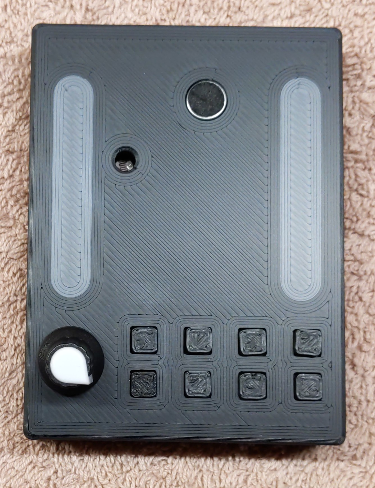
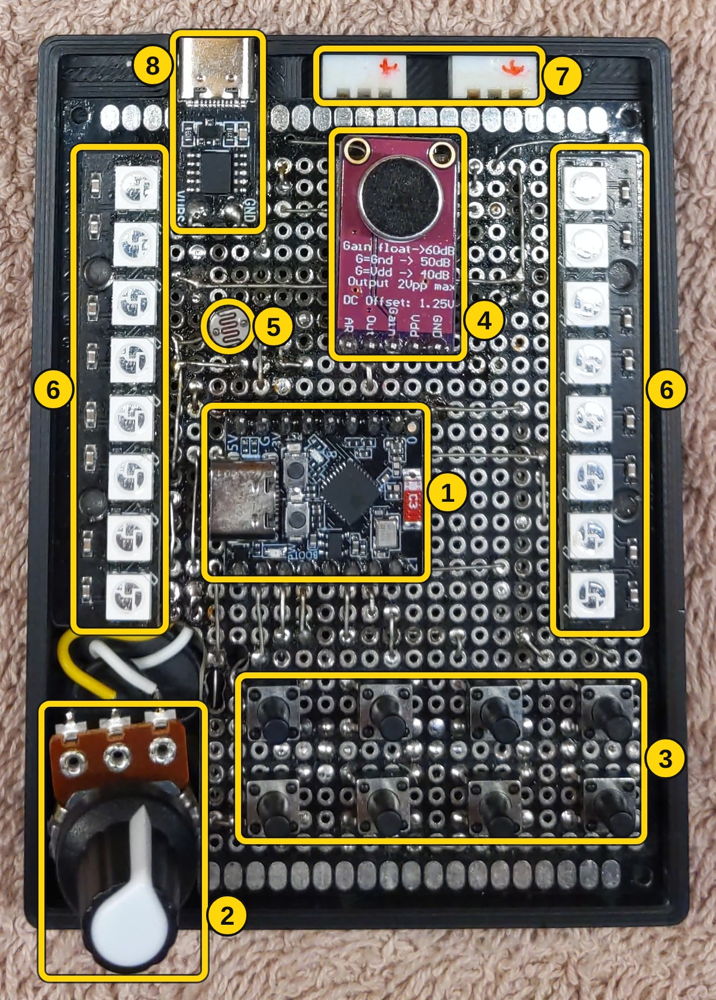
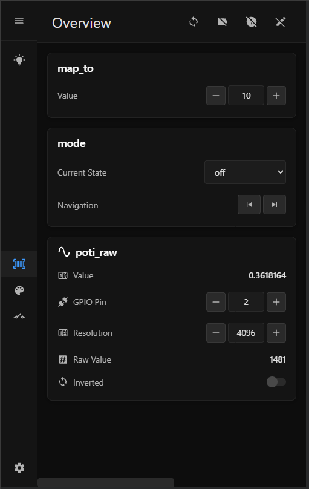
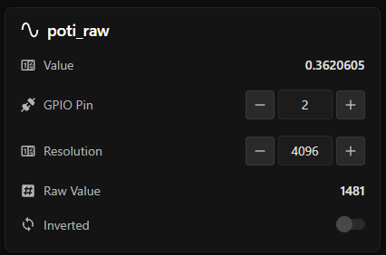

# NPX25 – ESP32-C3 NeoPixel LED Controller

[Deutsche Version](README.de.md)

A hand-built LED light with two NeoPixel strips and a growing set of light modes, running on an ESP32-C3 microcontroller with MicroPython. It is controlled either directly on the device with buttons and knobs, or from a responsive web page.


<br>

<br>

# Hardware

<br>

## The story behind it

NPX25 is the modern answer to an original from around 1980, built in the GDR by an electrician. It is a *Lichtschlauch*, a light tube: a chain of motorcycle lamps painted in four colours, driven by a control box that makes them run. Everything in that box was made by hand. A transformer wound on an iron core brings 240 V mains down to 12 V, and the lamps run straight on that AC. An etched circuit board carries 5 V logic that switches the four colour channels in fixed sequences, a running light among them, with large sliding potentiometers on the front for speed. It still works today.

Seeing it raised the obvious question: could the same thing be done with a microcontroller the size of a coin, an addressable LED strip and some code? NPX25 is that answer. Four colour channels became 234 individually addressable LEDs, fixed sequences became patterns in software, and the control box shrank to a small 3D-printed case. The original and the new one now stand side by side.

| The original, around 1980 | NeoPixel 2025 |
|---|---|
|  |  |
| *Outside* | *Outside* |
|  |  |
| *Inside* | *Inside* |


*The light tube itself, here on the new controller.*

<br>

## What it does

NPX25 drives two LED strips of 117 pixels each: 8 pixels sit on the controller board and shine through the thin case wall as a small preview, the remaining 109 run through the light tube. Every pixel can show its own colour, so a mode is not a wiring diagram but a small piece of software, and new ones are added in code without touching the hardware.

**Light modes**

| Mode | What you see |
|---|---|
| Static | The whole tube in one colour |
| Fade | A slow crossfade between two colours |
| Rainbow | A moving rainbow, brighter when the room is brighter |
| Running light | Dots of one colour chasing over a background of another, speed set by the knob |
| Sound bar | A level meter that grows with the sound in the room |
| Sound bar mirror | The same meter, growing from the middle outwards |
| Sound slider | A short bar that jumps along the tube with the sound |
| Black | Everything off |

**Controls on the device**

| Control | Does |
|---|---|
| 2 buttons | Mode next / previous |
| 2 buttons | Colour 1 up / down, through a palette of 15 preset colours |
| 2 buttons | Colour 2 up / down, same palette |
| 2 buttons | Brightness up / down, in 10 steps |
| Knob | Speed of the running light, sensitivity of the sound modes |
| Microphone | Sound level for the three sound modes |
| Light sensor | Ambient light, used by the rainbow mode |

The web dashboard shows the same settings and a few more, so the lamp can also be set from a phone on the same WiFi. More about that under [Web dashboard](#web-dashboard).

<br>

## Components and pinout

The controller is an **ESP32-C3 Super Mini** (Tenstar Robot, AliExpress), a board the size of a stamp with WiFi, USB-C and just enough GPIO for this project. It sits on a perfboard together with a 10 kΩ potentiometer, eight push buttons, a MAX9814 microphone module, an LDR as light sensor and two rows of eight WS2812B pixels that preview what the strips show. The strips themselves are WS2812B, 5 V, connected over 3-pin JST-XH (GND, Data, VCC). Power comes in through a USB-C PD trigger set to 5 V, which feeds both strips and the board; the USB port of the ESP itself is only used for flashing.

<table>
  <tr>
    <td></td>
    <td>
      1. ESP32-C3 Super Mini<br>
      2. Potentiometer<br>
      3. 8 push buttons<br>
      4. Microphone module (MAX9814)<br>
      5. Light sensor (LDR)<br>
      6. 2 × 8 onboard preview pixels<br>
      7. Connectors for the two strips<br>
      8. USB-C power input with PD trigger
    </td>
  </tr>
</table>

### Pinout

<table>
  <tr>
    <th>Connected</th><th>GPIO</th><th>ESP32-C3 Super Mini</th><th>GPIO</th><th>Connected</th>
  </tr>
  <tr>
    <td>Button: colour 2 down</td><td>5</td>
    <td rowspan="8"></td>
    <td>5V</td><td>USB 5 V</td>
  </tr>
  <tr><td>Button: colour 2 up</td><td>6</td><td>GND</td><td>GND</td></tr>
  <tr><td>Button: colour 1 down</td><td>7</td><td>3.3V</td><td>Sensor supply</td></tr>
  <tr><td>Button: colour 1 up</td><td>8</td><td>4</td><td>Light sensor (ADC)</td></tr>
  <tr><td>LED strip 1 (117 px)</td><td>9</td><td>3</td><td>Potentiometer (ADC)</td></tr>
  <tr><td>Button: brightness up</td><td>10</td><td>2</td><td>LED strip 2 (117 px)</td></tr>
  <tr><td>Button: brightness down</td><td>20</td><td>1</td><td>Microphone (ADC)</td></tr>
  <tr><td>Button: mode previous</td><td>21</td><td>0</td><td>Button: mode next</td></tr>
</table>

All buttons switch to GND and use the internal pull-up, debounced in software (50 ms). Each strip has 117 pixels: zone 0 is the 8 onboard preview pixels, zone 1 the tube. On strip 1 the preview zone is inverted so both previews run in the same direction. Pins and zones are not hard-coded, they live in `config_npx25/`, see [Data container and config system](#data-container-and-config-system).

<br>

## 3D-printed case

The case is a FreeCAD design in three parts: a bottom shell that holds the perfboard, a top with the cut-outs for the buttons, the knob, the light sensor and the two preview windows, and eight button caps. Everything is a press fit, no screws, no glue, and it holds together firmly. The preview windows are printed in white, two layers thin, so the colours of the onboard pixels shine through. Model and print notes: [3d-print/README.md](3d-print/README.md).


*Top from the inside, top from the outside, bottom shell, the button caps and the bare board.*

<br>

<br>

# Software

<br>

## Web dashboard

<table>
  <tr>
    <td></td>
    <td></td>
  </tr>
  <tr>
    <td><i>Desktop: sidebar, one card per component</i></td>
    <td><i>Phone: collapsed sidebar, single column</i></td>
  </tr>
</table>

The ESP serves a small single-page dashboard from its own flash: plain HTML, CSS and JavaScript, no framework, no build step, with a look inspired by Home Assistant. It joins the home WiFi, and if that fails it opens its own access point so the page is always reachable.

The page is not written per device, it is generated. Every card describes its own fields in a metadata dictionary (type, label, widget, range, choices) and the browser renders the matching widget from that description. A new component in the config shows up in the dashboard without touching the front end.

The sidebar has three kinds of pages, all built from the same cards:

- **Favourites**: hand-picked controls, reordered by drag and drop in an edit mode
- **Containers**: one page per container, such as *root* for everything, *patterns* or *buttons*
- **Settings**: WiFi and web server, also just cards

Values are polled once per second in a single batched request.

| Call | Purpose |
|---|---|
| `GET /api/sidebar` | Sidebar content: pages and icons |
| `POST /api/cards` | Cards for one page, built from the metadata |
| `POST /api/get` | Batched read of values by path |
| `POST /api/set` | Write one value by path |

Request and response examples: [API reference](docs/api.md).

<br>

## Project layout

*todo*

<br>

## From config to card

**The problem**: every sensor, button or pattern needed three things written by hand. The Python class, a form on the web page for its settings, and the config entry that creates it. Each new field had to be added in all three places, and a change in one broke the other two.

**The idea**: the class describes itself once, in a metadata dictionary next to its code. The config loader reads that description to create the instance, the web page reads it to draw the card, and the API reads it to know what may be read or written. Nothing is written per instance.

The poti in the screenshots above is the simplest example, an `AnalogSensor`, followed here from the JSON to the card.

<br>

### 1. Config

[sensors.json](config/sensors.json)

```json
"poti_raw": {
    "class": "AnalogSensor",
    "values": { "pin": 2 },
    "meta": { "pin": { "write": false } }
}
```

- **`"poti_raw"`**: the id of the element
  - `dc.poti_raw` in Python Datacontaner
  - `POST /api/get ["poti_raw.value"]` in the API
- **`class`**: the Python class name
- **`values`**: Values for the attributes defined in `METADATA`
- **`meta`**: overrides Default Attributes in `METADATA`

**Data-Centric**: It states what Values look like, while Python attaches it to variables/functions. That makes it easy for the API to apply changes Persistently in the config files. 


<br>

### 2. Python

[analog_sensor.py](hw/analog_sensor.py)

```python
class AnalogSensor(Component):
    METADATA = {
        'pin':        {'label': 'GPIO Pin',   'widget': 'number', 'min': 0, 'max': 21},
        'resolution': {'label': 'Resolution', 'widget': 'number', 'default': 4096},
        'inverted':   {'label': 'Inverted',   'widget': 'toggle', 'default': False},
        'raw_value':  {'label': 'Raw Value',  'widget': 'text',   'update': True},
        'value':      {'label': 'Value',      'widget': 'text',   'update': True},
    }

    # Simplified Initialization, would happen in Component with **kwargs
    def __init__(self, pin, resolution, inverted):
        self.pin        = pin
        self.resolution = resolution  # or METADATA default
        self.inverted   = inverted    # or METADATA default

    def raw_value(self): ...
    def value(self): ...
```

**Component**: the base class; Reads METADATA, assigns the init values
- Provides Class Attributes: `name`, `meta`, `icon`, `**kwargs`
- offers`get_value()` / `set_value()` for outside access 

<br>

**METADATA**: variables / functions declared to expose to the API. 
- `'pin': {..}`: Points to variable `self.pin` by name
- `'value': {..}`: Points to method `self.value()` by name
- all keys in [docs/meta.md](docs/meta.md)

<br>

### 3. Web interface



`POST /api/cards` returns the metadata with current values as JSON, and the browser turns each entry into a row: `widget` picks the control, `label` the text, `write` decides whether it is editable, `update` marks it for the one-second polling over `/api/get`. Changing a value in the card is a `POST /api/set` that ends in `set_value()` on the instance. Rows appear in the order of the dictionary.

Source: [hw/analog_sensor.py](hw/analog_sensor.py) · Config: [config/sensors.json](config/sensors.json)

<br>

## Data container and config system

*todo* → [Config reference](docs/config.md)

<br>

## Pipelines and state machine

*todo*

<br>

## Getting started

*todo* → [Installation guide](docs/INSTALL.md)

<br>

<br>

# Status and what I learned

<br>

## Known limitations

*todo*

<br>

## Next steps

*todo*

<br>

<br>

# Credits

*todo*
