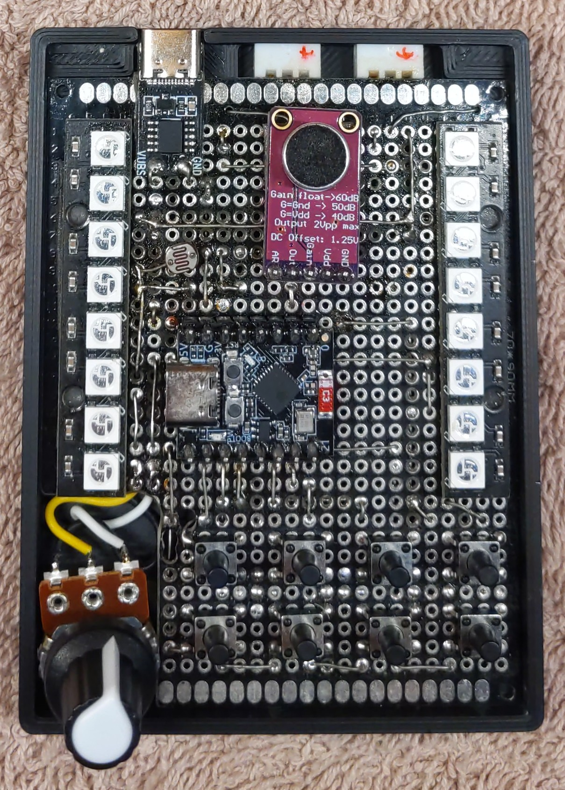
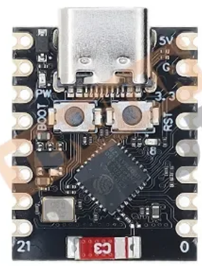
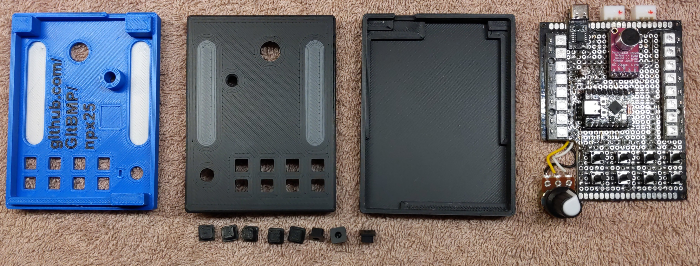
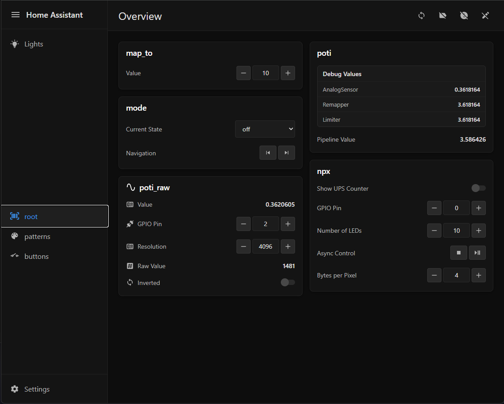
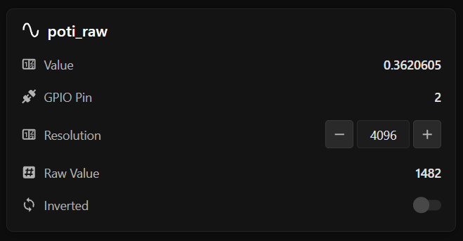

# NPX25 – ESP32-C3 NeoPixel LED Controller

[Deutsche Version](README.de.md)

A hand-built LED light with two NeoPixel strips and a growing set of light modes, running on an ESP32-C3 microcontroller with MicroPython. It is controlled either directly on the device with buttons and knobs, or from a responsive web page.


<br>

<br>

# Hardware

<br>

## The story behind it

NPX25 is the modern answer to an original from around 1980, built in the GDR by an electrician. It is a *Lichtschlauch*, a light tube: a chain of motorcycle lamps painted in four colours, driven by a control box that makes them run. Everything in that box was made by hand. A transformer wound on an iron core brings 240 V mains down to 12 V, and the lamps run straight on that AC. An etched circuit board carries 5 V logic that switches the four colour channels in fixed sequences, a running light among them, with large sliding potentiometers on the front for speed. It still works today.

Seeing it raised the obvious question: could the same thing be done with a microcontroller the size of a coin, an addressable LED strip and some code? NPX25 is that answer. Four colour channels became 234 individually addressable LEDs, fixed sequences became patterns in software, and the control box shrank to a small 3D-printed case. The original and the new one now stand side by side.

| The original, around 1980 | NeoPixel 2025 |
|---|---|
|  |  |
| *Outside* | *Outside* |
|  |  |
| *Inside* | *Inside* |


*The light tube itself, here on the new controller.*

<br>

## What it does

NPX25 drives two LED strips of 117 pixels each: 8 pixels sit on the controller board and shine through the thin case wall as a small preview, the remaining 109 run through the light tube. Every pixel can show its own colour, so a mode is not a wiring diagram but a small piece of software, and new ones are added in code without touching the hardware.

**Light modes**

| Mode | What you see |
|---|---|
| Static | The whole tube in one colour |
| Fade | A slow crossfade between two colours |
| Rainbow | A moving rainbow, brighter when the room is brighter |
| Running light | Dots of one colour chasing over a background of another, speed set by the knob |
| Sound bar | A level meter that grows with the sound in the room |
| Sound bar mirror | The same meter, growing from the middle outwards |
| Sound slider | A short bar that jumps along the tube with the sound |
| Black | Everything off |

**Controls on the device**

| Control | Does |
|---|---|
| 2 buttons | Mode next / previous |
| 2 buttons | Colour 1 up / down, through a palette of 15 preset colours |
| 2 buttons | Colour 2 up / down, same palette |
| 2 buttons | Brightness up / down, in 10 steps |
| Knob | Speed of the running light, sensitivity of the sound modes |
| Microphone | Sound level for the three sound modes |
| Light sensor | Ambient light, used by the rainbow mode |

The web dashboard shows the same settings and a few more, so the lamp can also be set from a phone on the same WiFi. More about that under [Web dashboard](#web-dashboard).

<br>

## Components and pinout

The controller is an **ESP32-C3 Super Mini** (Tenstar Robot, AliExpress), a board the size of a stamp with WiFi, USB-C and just enough GPIO for this project. It sits on a perfboard together with a 10 kΩ potentiometer, eight push buttons, a MAX9814 microphone module, an LDR as light sensor and two rows of eight WS2812B pixels that preview what the strips show. The strips themselves are WS2812B, 5 V, connected over 3-pin JST-XH (GND, Data, VCC). Power comes in through a USB-C PD trigger set to 5 V, which feeds both strips and the board; the USB port of the ESP itself is only used for flashing.

<table>
  <tr>
    <td></td>
    <td>
      1. ESP32-C3 Super Mini<br>
      2. Potentiometer<br>
      3. 8 push buttons<br>
      4. Microphone module (MAX9814)<br>
      5. Light sensor (LDR)<br>
      6. 2 × 8 onboard preview pixels<br>
      7. Connectors for the two strips<br>
      8. USB-C power input with PD trigger
    </td>
  </tr>
</table>

### Pinout

<table>
  <tr>
    <th>Connected</th><th>GPIO</th><th>ESP32-C3 Super Mini</th><th>GPIO</th><th>Connected</th>
  </tr>
  <tr>
    <td>Button: colour 2 down</td><td>5</td>
    <td rowspan="8"></td>
    <td>5V</td><td>USB 5 V</td>
  </tr>
  <tr><td>Button: colour 2 up</td><td>6</td><td>GND</td><td>GND</td></tr>
  <tr><td>Button: colour 1 down</td><td>7</td><td>3.3V</td><td>Sensor supply</td></tr>
  <tr><td>Button: colour 1 up</td><td>8</td><td>4</td><td>Light sensor (ADC)</td></tr>
  <tr><td>LED strip 1 (117 px)</td><td>9</td><td>3</td><td>Potentiometer (ADC)</td></tr>
  <tr><td>Button: brightness up</td><td>10</td><td>2</td><td>LED strip 2 (117 px)</td></tr>
  <tr><td>Button: brightness down</td><td>20</td><td>1</td><td>Microphone (ADC)</td></tr>
  <tr><td>Button: mode previous</td><td>21</td><td>0</td><td>Button: mode next</td></tr>
</table>

All buttons switch to GND and use the internal pull-up, debounced in software (50 ms). Each strip has 117 pixels: zone 0 is the 8 onboard preview pixels, zone 1 the tube. On strip 1 the preview zone is inverted so both previews run in the same direction. Pins and zones are not hard-coded, they live in `config_npx25/`, see [Data container and config system](#data-container-and-config-system).

<br>

## 3D-printed case

The case is a FreeCAD design in three parts: a bottom shell that holds the perfboard, a top with the cut-outs for the buttons, the knob, the light sensor and the two preview windows, and eight button caps. Everything is a press fit, no screws, no glue, and it holds together firmly. The preview windows are printed in white, two layers thin, so the colours of the onboard pixels shine through. Model and print notes: [_3d-print/README.md](_3d-print/README.md).



*Top from the inside, top from the outside, bottom shell, the button caps and the bare board.*

<br>

<br>

# Software

<br>

## Web dashboard

<table>
  <tr>
    <td></td>
    <td></td>
  </tr>
  <tr>
    <td><i>Desktop: sidebar, one card per component</i></td>
    <td><i>Phone: collapsed sidebar, single column</i></td>
  </tr>
</table>

The ESP serves a small single-page dashboard from its own flash: plain HTML, CSS and JavaScript, no framework, no build step, with a look inspired by Home Assistant. It joins the home WiFi, and if that fails it opens its own access point so the page is always reachable.

The page is not written per device, it is generated. Every card describes its own fields in a metadata dictionary (type, label, widget, range, choices) and the browser renders the matching widget from that description. A new component in the config shows up in the dashboard without touching the front end.

The sidebar has three kinds of pages, all built from the same cards:

- **Favourites**: hand-picked controls, reordered by drag and drop in an edit mode
- **Containers**: one page per container, such as *root* for everything, *patterns* or *buttons*
- **Settings**: WiFi and web server, also just cards

Values are polled once per second in a single batched request.

| Call | Purpose |
|---|---|
| `GET /api/sidebar` | Sidebar content: pages and icons |
| `POST /api/cards` | Cards for one page, built from the metadata |
| `POST /api/get` | Batched read of values by path |
| `POST /api/set` | Write one value by path |

Request and response examples: [API reference](_docs/api.md).

<br>

## From config to card

**The problem**:  
Every sensor, button or pattern needed three things written by hand: the Python class, its representation on the web page, and the config entry that creates it. Furthermore, everything has to be connected, e.g. a web request has to find its way to the right field in the config.

**The solution**:  
Let the class describe itself. A `METADATA` dictionary next to the code lists what the class exposes. The config creates the instance from it, the web page draws the card from it, and the API knows what may be read or written. Nothing in Python is written per instance.

**We need two things**:
- `id`: the name of the instance
- `METADATA`: what the class provides

**What does it provide**:
- **Visibility**: what is visible to the outside world
- **Accessibility**: `read` / `write` control the access
- **Query**: get all instances with their attributes and methods
- **Persistence**: write back to the config (WIP)

**Is the web server the limit?**  
No. The same description can feed other interfaces, such as MQTT or a built-in display.

**Example**:  
The following goes through a full example with the class `AnalogSensor`: the config, the relevant part of the Python class, and the card on the web page.

<br>

### 1. Config

[sensors.json](config/sensors.json)

```json
"poti_raw": {
    "class": "AnalogSensor",
    "values": { "pin": 2 },
    "meta": { "pin": { "write": false, "widget": "text" } }
}
```

- **`"poti_raw"`**: the `id` of the instance
  - **Python** `dc.poti_raw`: returns the instance
  - **API** `POST /api/get ["poti_raw.pin"]` → `{ "poti_raw.pin": 2 }`
- **`class`**: the Python class name
- **`values`**: values for the attributes listed in `METADATA`
- **`meta`**: overrides `METADATA` entries for this instance
- all keys, references and function calls in [_docs/config.md](_docs/config.md)

**Data-centric**: the config states values, and the class decides what to do with them. Function calls are possible with `calls`, but the exception.

**What `values` can we set?**  
Everything that has a key in `METADATA`, so let's look at the class.

<br>

### 2. Python

[analog_sensor.py](hw/analog_sensor.py)

```python
class AnalogSensor(Component):
    METADATA = {
        'pin':        {'label': 'GPIO Pin',   'widget': 'number', 'min': 0, 'max': 21},
        'resolution': {'label': 'Resolution', 'widget': 'number', 'default': 4096},
        'inverted':   {'label': 'Inverted',   'widget': 'toggle', 'default': False},
        'raw_value':  {'label': 'Raw Value',  'widget': 'text',   'update': True},
        'value':      {'label': 'Value',      'widget': 'text',   'update': True},
    }

    # Simplified initialization, done by Component with **kwargs
    def __init__(self, pin, resolution, inverted):
        self.pin        = pin
        self.resolution = resolution  # or METADATA default
        self.inverted   = inverted    # or METADATA default

    def raw_value(self): ...
    def value(self): ...
```

**Component**: the base class
- reads `METADATA` and assigns the init values
- provides `name`, `icon` and the merged `meta` of the instance
- offers `get_value()` / `set_value()` for access from outside

<br>

**METADATA**: the attributes and methods exposed to the API
- `'pin': {..}`: points to the attribute `self.pin` by name
- `'value': {..}`: points to the method `self.value()` by name
- all keys in [_docs/meta.md](_docs/meta.md)

**That's it**  
The class and its `METADATA` are defined, the web page comes for free.

<br>

### 3. Web interface

<table>
  <tr>
    <td>
      <b>One row per <code>METADATA</code> entry</b><br><br>
      <code>label</code>: the text on the left<br>
      <code>widget</code>: the control on the right, <code>number</code>, <code>toggle</code> or plain <code>text</code><br>
      <code>write</code>: editable or display only; <code>pin</code> is locked by the config and shown as plain text<br>
      <code>update</code>: polled once a second, that's why <code>value</code> moves
    </td>
    <td></td>
  </tr>
</table>

Nothing here was written for `AnalogSensor`; the card is drawn from the metadata.

<br>

## Data container

**The problem**:  
A button needs the LED strip, a pattern needs the poti, the web server needs everything. Passing references around by hand ends in a tangle of constructor arguments.

**The solution**:  
One global tree. Every instance is stored once in the `DC` singleton and reachable from anywhere by its path.

```python
from tools import DC, DataContainer
from hw import Button

dc = DC()                       # singleton, the same object everywhere
dc.value = 5
dc.buttons = DataContainer()    # nested container
dc.buttons.btn1 = Button(pin=1) # path is now 'buttons.btn1'
```

- **Path**: assigning an object to the tree sets its path. The card title `poti_raw` in the screenshot is that path.
- **Config**: `$buttons.btn1` in any config string is `dc.buttons.btn1`, that's how instances reference each other.
- **API**: paths are used as they are, without `dc.`: `["buttons.btn1.pin"]`
- **Sidebar**: every container is a page: `root` is `dc`, `buttons` is `dc.buttons`

<br>

## Pipelines

**The problem**:  
Sensor values are raw. The poti gives 0 to 1 and the running light wants a speed from 1 to 50; the microphone needs smoothing, a limit and a sensitivity that follows the poti.

**The solution**:  
A `Pipeline` wraps a source and a list of processors. Each processor is a small class with its own `METADATA`, so the chain is configured in JSON and visible in the dashboard. The "Debug Values" list in the poti card above shows every stage.

```json
"sensors.poti_speed": {
    "class": "Pipeline",
    "values": { "source": "$sensors.poti" },
    "calls": [ { "add": { "processor": "$sensors.poti_speed_remapper" } } ]
}
```

- **Processors**: `Smoother`, `SmootherTime`, `Remapper`, `Limiter`, `ToInt`, `Power`, `Inverter`
- **Live parameters**: a processor parameter can be a `lambda`, the mic gain floor follows the inverted poti this way

<br>

## Project layout

```
npx25/
├── main.py          boot: logger, then ConfigLoader loads config/
├── config/          JSON config of the test setup (wifi.json is gitignored)
├── config_npx25/    JSON config of the real device: two strips, all modes
├── hw/              hardware classes: AnalogSensor, Button, Value, NPX, patterns
├── tools/           framework: Component, DataContainer, ConfigLoader, Pipeline,
│                    StateMachine, AsyncLoop, WebServer, WiFi
├── app/             the dashboard, static files served by the ESP
├── lib/microdot/    Microdot web framework, compiled .mpy
├── lib/_microdot/   Microdot source
├── _docs/           API, config and metadata reference, install guide, images
└── _3d-print/       FreeCAD model of the case
```

Files and folders starting with `_` are not uploaded to the device.

<br>

<br>

# Status and what I learned

<br>

## Known limitations

- **Persistence**: changes made in the dashboard are not yet written back to the config files
- **RAM**: `config/` runs reliably. The full `config_npx25/` with two strips, eight modes and a pattern instance per strip and zone does crash during boot on the ESP32-C3
- **Patterns per zone**: change detection lives in the pattern instance, so every pattern exists four times. That is can be one RAM improvement.

<br>

## Heap fragmentation

**The problem**:  
MicroPython reports plenty of free memory, and an allocation still fails. Free memory is a total, but an object needs one contiguous block.

**How it happens**, using the config loader as example:  
The JSON file is read as text, parsed, and then every entry is instantiated. Direct objects (DO) have no dependencies and are created at once; waiting objects (WO) need a reference that does not exist yet and are created in a later pass.

```
| file 4 kB | JSON 2 kB | DO | DO | WO | DO | WO | WO |
```

File text and JSON are garbage soon, and the WOs are replaced one by one later. What stays is a heap with holes:

```
|-----------------------| DO | DO | -- | DO | -- | -- |
```

The holes add up to a comfortable number, but none of them is big enough for the next large object. A high-level language hides addresses and allocation, which makes this hard to see until it fails.

<br>

## Next steps

- **Allocate in order**: create long-lived objects first and in one go, e.g. pre-allocate the loader's object slots, so temporaries and instances do not interleave
- **Ship bytecode**: compile `.py` to `.mpy` on the PC, so the ESP never holds the source text and the compiler's working memory; freeze the framework into the firmware
- **One pattern per class**: move the change detection out of the instance, so a pattern is created once and shared by all zones
- **Rust or C++**: no garbage collector, explicit allocation, buffers sized for the job. That is where the next version goes
- **Case**: button caps with icons, sun and moon for brightness, arrows for mode and colour

<br>

<br>

# Credits

- [Microdot](https://github.com/miguelgrinberg/microdot) by Miguel Grinberg, MIT license, the web framework behind the dashboard
- [Material Design Icons](https://pictogrammers.com/library/mdi/) by Pictogrammers, the icon set in the dashboard
- [Home Assistant](https://www.home-assistant.io/) for the look of the dashboard
- The original Lichtschlauch from 1980, for the idea
