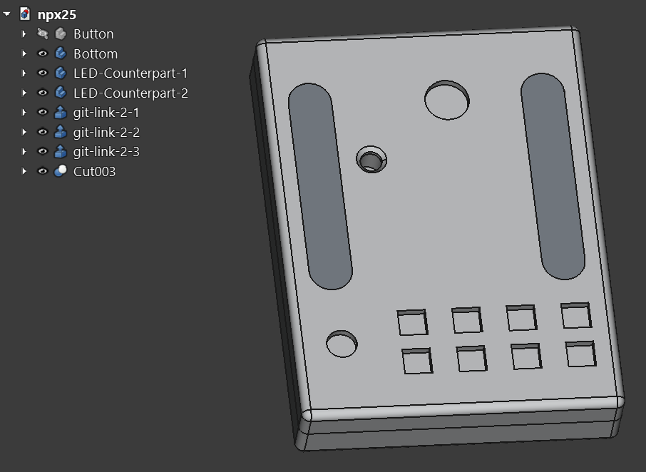

[← Back to README](../README.md#3d-printed-case)

# NPX25 – 3D-printed case

`npx25.FCStd` holds the complete case: bottom shell, top and button caps, all in one file, made with FreeCAD 1.0. The parts are a press fit, so there are no screws and no threads.

<table>
  <tr>
    <td></td>
    <td>
      <b>Bodies in the model</b>  
      <code>Bottom</code> – bottom shell 
      <code>Cut003</code> – top 
      <code>Button</code> – button cap, print 8× 
      <code>LED-Counterpart-1/2</code> – preview windows (grey) 
      <code>git-link-2-1/2/3</code> – embossed link inside the top
    </td>
  </tr>
</table>

 

## Printing

PLA, 0.6 mm nozzle. The bottom shell and the button caps print as modelled, the top face down (see below). Supports are only needed for the JST cut-outs in the bottom shell, not for the caps.

**Exporting for your slicer:** open the file in FreeCAD, select a body in the tree, File → Export, choose STL or 3MF, repeat for each part. STL and 3MF files are ignored by git on purpose, the FreeCAD file is the source.

 

## Multicolour top

The white preview windows and the embossed link on the inside of the top are separate bodies in the model, so a multi-material printer can print them in a second colour.

1. Export these six bodies from FreeCAD: `Cut003` (the top itself), `LED-Counterpart-1`, `LED-Counterpart-2`, `git-link-2-1`, `git-link-2-2`, `git-link-2-3`.
2. In PrusaSlicer (or the slicer of your choice) import `Cut003`, right-click it in the object tree, *Add part → Load…*, and load the other five bodies into the same object.
3. Rotate the object 180° around X so the top prints face down.
4. Assign the second colour to the five added parts and slice.

Printed on a stock Prusa MK4 with a multicolour profile and manual filament changes.
